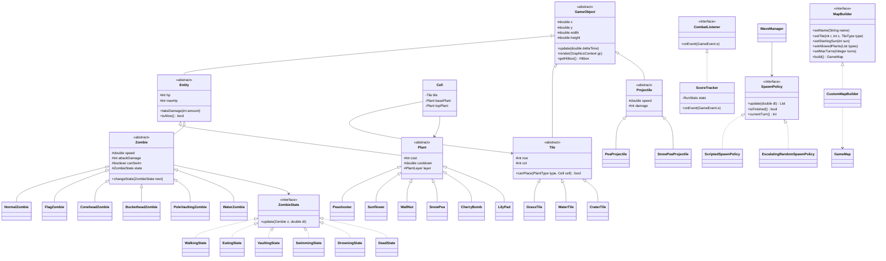

# Plants vs. Zombies - Map Builder & Survival (OOP Project)

Đồ án môn Lập trình Hướng đối tượng.

## 1. Công nghệ sử dụng (Tech Stack)
- **Ngôn ngữ:** Java (JDK 17+)
- **Đồ họa & Âm thanh:** JavaFX (Controls, Canvas, Media)
- **Quản lý build:** Maven
- **Xử lý JSON (Map, Spec, Kỷ lục):** Google Gson
- **Kiểm thử:** JUnit 5

## 2. Giới thiệu
Game mô phỏng Plants vs. Zombies với 2 chế độ chơi. **Không có cây trồng sẵn ở bất kỳ chế độ nào**: mọi trận đều bắt đầu với bàn cờ trống.

- **Campaign Mode:** Các màn có sẵn (Ban ngày, Bể bơi), wave zombie theo kịch bản cố định trong file JSON. Thắng khi vượt qua wave cuối.
- **Custom Mode (Sinh tồn):** Người chơi dùng **Map Editor** để:
  - Vẽ địa hình lưới 5x9 bằng cách click hoặc kéo: **Cỏ**, **Nước**, **Hố**.
  - Chọn **Sun khởi đầu**.
  - Chọn **các loại cây** được xuất hiện trong thanh chọn cây.
  - Chọn **số turn zombie**, hoặc tick **Vô hạn**.
  - Đặt tên, lưu map, mở lại map đã lưu, hoặc **Chơi thử** ngay.

  Zombie xuất hiện ngẫu nhiên và dồn dập dần theo thời gian. Mỗi trận được **tính điểm** và lưu **kỷ lục** theo từng bố cục map.

## 3. Luật chơi chế độ Custom

### 3.1 Địa hình
| Ô | Trồng cây | Zombie |
|---|---|---|
| **Cỏ** | Mọi cây, trừ LilyPad | Đi bình thường |
| **Nước** | Ô trống chỉ trồng được **LilyPad**; có LilyPad rồi thì trồng thêm 1 cây lên trên | Biết bơi thì bơi qua, không biết bơi thì **chết đuối** |
| **Hố** | Không trồng được gì | Đi qua bình thường |

### 3.2 Xuất hiện zombie (Spawn)
- Spawn **chạy theo thời gian**, không chờ zombie turn trước chết hết.
- Đầu trận có **thời gian ân hạn** (`gracePeriod`) không ra zombie, để người chơi kịp trồng cây đầu tiên.
- Mỗi **turn** kéo dài `turnDuration` giây. Trong turn thứ `n`, cứ mỗi `interval(n)` giây ra 1 zombie ở **hàng ngẫu nhiên**:

  ```
  interval(n) = max(T_min, T0 · decay^n)        // 0 < decay < 1
  ```

- **Loại zombie** được chọn ngẫu nhiên theo bảng trọng số thay đổi theo turn: turn sớm chủ yếu Normal, turn muộn có thêm Buckethead.
- Mỗi đầu turn có 1 **FlagZombie** dẫn đầu và hiện banner "Turn n".
- Có **trần số zombie cùng lúc** (`maxAliveZombies`) để giữ FPS ổn định.
- Toàn bộ tham số spawn nằm trong `resources/data/spawn_spec.json` và dùng chung cho mọi map. File map **không** chứa tham số spawn.

### 3.3 Bơi và chết đuối
- Mỗi **loại** zombie có một tỉ lệ chết đuối riêng (`drownChance`) trong `zombies_spec.json`. Người chơi không nhìn thấy tỉ lệ này và tự khám phá qua quá trình chơi.
- **Lúc spawn**, mỗi con tung xúc xắc một lần: `canSwim = random.nextDouble() >= drownChance`.
- `WaterZombie` (đi phao) có `drownChance = 0`, tức là luôn bơi được.
- Khi mép trước hitbox của zombie đi vào ô Nước:
  - `canSwim = true` → chuyển sang `SwimmingState`. Rời nước sang ô cỏ thì quay về `WalkingState`.
  - `canSwim = false` → chuyển sang `DrowningState` (animation chìm) rồi `DeadState`.
- **Thứ tự kiểm tra:** kiểm tra chết đuối **trước**, va chạm cây **sau**. Vì vậy zombie không biết bơi không bao giờ ăn được cây trên mặt nước.
- `PoleVaultingZombie` nhảy qua cây rồi đáp xuống ô nước thì kiểm tra chết đuối **tại chỗ đáp**.

### 3.4 LilyPad và zombie biết bơi
- Mỗi ô (`Cell`) giữ 2 tầng cây: `basePlant` (LilyPad) và `topPlant` (cây trồng trên LilyPad).
- Zombie đang bơi tới ô có LilyPad sẽ **ăn `topPlant` trước, sau đó ăn LilyPad**. Ăn xong LilyPad thì ô trở lại thành nước trống.
- Ăn xong, `EatingState` hỏi `TerrainQuery` để quay về **đúng** state: ô nước thì về `SwimmingState`, ô cỏ thì về `WalkingState`.

### 3.5 Tương tác khác
- **Xe cắt cỏ** chạy hết hàng bất kể địa hình, diệt cả zombie đang bơi.
- **CherryBomb** nổ trúng mọi zombie trong vùng 3x3, kể cả zombie đang bơi.
- **Mặt trời** rơi xuống ô nước vẫn nhặt được bình thường.

### 3.6 Kết thúc trận
| Cấu hình | Thắng | Thua |
|---|---|---|
| Có số turn `N` | Vượt qua hết turn N **và** dọn sạch sân | Zombie vào nhà |
| **Vô hạn** (`maxTurns = null`) | Không có thắng, trận chỉ kết thúc khi thua | Zombie vào nhà |

### 3.7 Tính điểm
```
Điểm = (Điểm giết + Điểm thời gian + Thưởng turn + Thưởng thắng) × Hệ số Sun
```
| Thành phần | Cách tính |
|---|---|
| Điểm giết | Normal 10 · Water 15 · Cone 20 · Pole 25 · Bucket 40. **Zombie chết đuối chỉ tính 50%** |
| Điểm thời gian | 1 điểm mỗi giây sinh tồn, cộng dồn `deltaTime` và **không tính thời gian Pause** |
| Thưởng turn | 100 × số turn đã vượt qua |
| Thưởng thắng | Chỉ áp dụng khi có giới hạn turn: 500 + 100 × số xe cắt cỏ còn lại |
| Hệ số Sun | `clamp(150 / sunKhởiĐầu, 0.5, 2.0)`: 50 Sun được ×2.0, 150 Sun được ×1.0, 300 Sun trở lên được ×0.5 |

Mọi hệ số nằm trong `resources/data/score_spec.json` để nhóm cân bằng mà không phải sửa code.

### 3.8 Kỷ lục
- Kỷ lục gắn với **bố cục map**: mã băm SHA-256 của `tiles + allowedPlants`, **không tính** Sun và số turn. Cùng một địa hình chơi với Sun hoặc số turn khác nhau thì vẫn chung một bảng kỷ lục.
- Mỗi kỷ lục lưu: **Sun khởi đầu, số turn (hoặc ∞), số turn đạt được, thời gian sinh tồn**, kết quả, số zombie bị giết, số zombie chết đuối, điểm, thời điểm chơi.
- Giữ **top 10 mỗi bố cục**. Sắp xếp theo điểm giảm dần; bằng điểm thì thời gian dài hơn đứng trên; vẫn bằng thì trận chơi trước đứng trên.
- Nút **Chơi thử** trong editor **không lưu kỷ lục**, chỉ hiển thị điểm kèm nhãn "Chơi thử – không lưu kỷ lục".

### 3.9 Kiểm tra cấu hình trong Map Editor
| Cấu hình | Xử lý |
|---|---|
| Không chọn cây nào | **Chặn lưu** |
| Có ô nước nhưng không chọn LilyPad | Cảnh báo |
| Không chọn Sunflower | Cảnh báo (Sun chỉ đến từ trời) |
| Không chọn cây tấn công nào | Cảnh báo |
| Có hàng toàn ô Hố | Cảnh báo (hàng đó không thể phòng thủ) |
| Chưa đặt tên map | Chặn lưu |

### 3.10 Ví dụ file map Custom
```json
{
  "name": "Ao giữa sân",
  "mode": "CUSTOM",
  "tiles": [
    ["GRASS","GRASS","WATER","GRASS","GRASS","GRASS","GRASS","GRASS","GRASS"],
    ["GRASS","WATER","WATER","GRASS","WATER","GRASS","GRASS","GRASS","GRASS"],
    ["GRASS","GRASS","GRASS","GRASS","CRATER","WATER","GRASS","GRASS","GRASS"],
    ["GRASS","GRASS","GRASS","GRASS","CRATER","GRASS","GRASS","GRASS","GRASS"],
    ["GRASS","GRASS","GRASS","GRASS","GRASS","GRASS","GRASS","GRASS","GRASS"]
  ],
  "startingSun": 150,
  "allowedPlants": ["PEASHOOTER", "SUNFLOWER", "WALL_NUT", "LILY_PAD"],
  "maxTurns": 5
}
```
`"maxTurns": null` nghĩa là Vô hạn.

## 4. Áp dụng OOP & Design Patterns
- **Đóng gói / Kế thừa / Đa hình / Trừu tượng:** Cây phả hệ `GameObject` -> `Entity` -> `Plant` / `Zombie`, và `GameObject` -> `Tile` / `Projectile`.
- **Builder Pattern:** `MapBuilder` dựng `GameMap` từng bước, dùng cho cả màn mẫu (`LevelDirector`) và Map Editor.
- **Factory Method Pattern:** `PlantFactory`, `ZombieFactory` tạo đối tượng theo loại, nạp chỉ số từ file spec.
- **State Pattern:**
  - Trạng thái game: `Menu`, `Playing`, `Pause`, `Victory`, `GameOver`.
  - Trạng thái zombie: `Walking`, `Eating`, `Vaulting`, `Swimming`, `Drowning`, `Dead`.
- **Strategy Pattern:** `SpawnPolicy` tách cách ra zombie: `ScriptedSpawnPolicy` (Campaign) và `EscalatingRandomSpawnPolicy` (Custom). `WaveManager` chỉ giữ một `SpawnPolicy`, không cần `if (mode == CUSTOM)`.
- **Observer Pattern:** `CombatEventBus` phát sự kiện va chạm, zombie chết, cây bị ăn, nhặt Sun. Âm thanh, hiệu ứng và **hệ thống điểm** (`ScoreTracker`) đều lắng nghe qua bus này.
- **Singleton Pattern:** `ResourceManager` (load sprite/âm thanh), `GameManager`.

## 5. Phân chia công việc & Kiến thức chi tiết (5 thành viên)

### Thành viên 1: Core Engine, Grid & Trạng thái Game (Trung)
- **Nhiệm vụ & Thiết kế Class:**
  - `GameObject` (abstract): tọa độ `x`, `y`, kích thước `width`, `height`. Phương thức trừu tượng `update(double deltaTime)`, `render(GraphicsContext gc)`, `getHitbox()`.
  - `Entity` (abstract, kế thừa `GameObject`): thuộc tính `hp`, `maxHp`. Phương thức `takeDamage(int dmg)`, `isAlive()`.
  - `Tile` (abstract, kế thừa `GameObject`): `row`, `col`, `TileType`. Phương thức `canPlace(PlantType type, Cell cell)` do từng phân lớp quy định: `GrassTile`, `WaterTile`, `CraterTile`.
  - `Cell`: một ô của bàn cờ, giữ `Tile`, `basePlant` (LilyPad) và `topPlant`.
  - `TerrainQuery` (interface): `getTileType(int lane, double x)`. Cho zombie hỏi địa hình mà không phụ thuộc trực tiếp vào `GameBoard`.
  - `GameBoard`: ma trận `Cell[5][9]`, quản lý danh sách thực thể, ánh xạ pixel sang ô cờ, hiện thực `TerrainQuery`.
  - `GameManager` (Singleton): quản lý state hiện tại và số Sun của phiên chơi. `startNewGame(GameMap)` mở phiên mới, nạp Sun khởi đầu; `changeState(...)` chỉ chuyển state nên Pause/Resume giữ nguyên tiến độ.
  - `GameState`: interface theo **State Pattern** (`MenuState`, `PlayingState`, `PauseState`, `VictoryState`, `GameOverState`).
    - `PlayingState` cộng dồn thời gian sinh tồn (chỉ khi đang chơi), gọi `WaveManager`, kiểm tra 2 điều kiện kết thúc (có hoặc không có `maxTurns`).
    - `VictoryState` / `GameOverState` hiển thị chỉ số trận và gửi kỷ lục.
  - `GameLoop`: kế thừa `AnimationTimer` của JavaFX, tách biệt logic (`update`) và vẽ (`render`).
- **Kiến thức kỹ thuật chi tiết cần học:**
  1. **Game Loop 60 FPS & Delta Time:** tính khoảng thời gian giữa 2 khung hình để tốc độ không phụ thuộc phần cứng.
  2. **Toán chuyển đổi tọa độ Pixel - Grid:** `col = (int) ((mouseX - START_X) / CELL_WIDTH)`, `row = (int) ((mouseY - START_Y) / CELL_HEIGHT)`.
  3. **Mẫu thiết kế State & Singleton:** máy trạng thái game và Singleton cho `GameManager`.
  4. **JavaFX Canvas Rendering:** `GraphicsContext`, `gc.clearRect()`, vẽ theo lớp (tile → cây nền → cây trên → zombie → đạn → hiệu ứng → HUD).
- **Nguồn tài liệu chuyên sâu:**
  - [JavaFX AnimationTimer & Game Loop Guide](https://openjfx.io)
  - [Refactoring Guru: State Pattern in Java](https://refactoring.guru/design-patterns/state/java/example)
  - [Refactoring Guru: Singleton Pattern](https://refactoring.guru/design-patterns/singleton/java/example)
  - [Baeldung: Multidimensional Arrays in Java](https://www.baeldung.com/java-two-dimensional-arrays)

### Thành viên 2: Hệ sinh thái Cây trồng & Kinh tế Mặt trời (An Nguyên)
- **Nhiệm vụ & Thiết kế Class:**
  - `Plant` (abstract, kế thừa `Entity`): thuộc tính `cost`, `cooldown`, `attackSpeed`, `layer` (`BASE` cho LilyPad, `TOP` cho các cây khác).
  - Các phân lớp: `Sunflower` (sinh Sun theo chu kỳ), `Peashooter` (bắn đậu khi có zombie trên hàng), `SnowPea` (đậu băng làm chậm), `WallNut` (máu cao chắn đường), `CherryBomb` (nổ 3x3, trúng cả zombie đang bơi), `LilyPad` (đệm trên ô nước, cho phép trồng 1 cây lên trên).
  - `PlantFactory`: **Factory Method Pattern**, tạo cây theo `PlantType`, nạp chỉ số từ `plants_spec.json`.
  - `Sun`: rơi ngẫu nhiên từ trời hoặc sinh từ Sunflower, click để nhặt (nhặt được cả trên ô nước).
  - `CardSlot` & `DeckManager`: thanh chọn cây, **chỉ hiển thị các cây trong `allowedPlants` của map**, lớp phủ cooldown, kiểm tra số dư Sun.
- **Kiến thức kỹ thuật chi tiết cần học:**
  1. **Kế thừa đa cấp & Đa hình:** thêm cây mới không sửa logic cũ (Open/Closed Principle).
  2. **Quản lý Cooldown:** `CooldownTimer` dựa trên delta time, chuẩn hóa tỷ lệ hiển thị thanh hồi chiêu.
  3. **Hit Test click chuột:** nhận diện click trúng mặt trời bằng bounding box.
  4. **Mẫu thiết kế Factory Method:** tách logic tạo cây khỏi luồng điều khiển bàn cờ.
- **Nguồn tài liệu chuyên sâu:**
  - [Refactoring Guru: Factory Method Pattern](https://refactoring.guru/design-patterns/factory-method/java/example)
  - [Game Programming Patterns: Game Loop & Delta Time](https://gameprogrammingpatterns.com/game-loop.html)
  - [Oracle Java: Abstract Methods and Classes](https://docs.oracle.com/javase/tutorial/java/IandI/abstract.html)
  - [Jenkov: JavaFX Mouse Event Handling](https://jenkov.com/tutorials/javafx/events.html)

### Thành viên 3: Zombie AI, State Machine & Spawn (Ngọc Minh)
- **Nhiệm vụ & Thiết kế Class:**
  - `Zombie` (abstract, kế thừa `Entity`): thuộc tính `speed`, `attackDamage`, `currentLane`, `state`, `canSwim` (gán một lần lúc spawn theo `drownChance`).
  - Phân lớp: `NormalZombie`, `FlagZombie` (dẫn đầu mỗi turn), `ConeheadZombie` / `BucketheadZombie` (giáp phụ, đổi sprite khi vỡ giáp), `PoleVaultingZombie` (nhảy qua cây đầu tiên), `WaterZombie` (đi phao, luôn bơi được).
  - `ZombieFactory`: tạo zombie theo `ZombieType`, nạp chỉ số và `drownChance` từ `zombies_spec.json`, nhận `Random` được tiêm vào để tung `canSwim`.
  - **State Pattern cho Zombie:** interface `ZombieState` với `WalkingState`, `EatingState`, `VaultingState`, `SwimmingState`, `DrowningState`, `DeadState`.
    - `EatingState` ăn `topPlant` trước `basePlant`; ăn xong hỏi `TerrainQuery` để về `SwimmingState` hoặc `WalkingState`.
    - Kiểm tra chết đuối được ưu tiên trước kiểm tra va chạm cây.
  - **Strategy Pattern cho Spawn:**
    - `SpawnPolicy` (interface): `List<SpawnRequest> update(double dt)`, `boolean isFinished()`, `int currentTurn()`.
    - `ScriptedSpawnPolicy`: đọc `Wave` / `WaveEntry` từ file màn Campaign.
    - `EscalatingRandomSpawnPolicy`: thời gian ân hạn, `interval(n) = max(T_min, T0 · decay^n)`, hàng ngẫu nhiên, loại zombie theo trọng số từng turn, `maxTurns` có thể `null`, trần `maxAliveZombies`.
  - `WaveManager`: giữ một `SpawnPolicy`, chuyển `SpawnRequest` thành zombie trên bàn cờ, phát banner "Turn n".
- **Kiến thức kỹ thuật chi tiết cần học:**
  1. **Finite State Machine (FSM):** tách hành vi zombie, chuyển trạng thái không dùng `if-else` lồng nhau.
  2. **Safe Removal:** dùng `Iterator<Zombie>` loại bỏ zombie đã chết, tránh `ConcurrentModificationException`.
  3. **Lập lịch theo thời gian:** bộ đếm tích lũy, dùng `while` (không dùng `if`) để spawn bù khi frame bị giật; chỉ cộng dồn trong `PlayingState`.
  4. **Ngẫu nhiên kiểm thử được:** tiêm `java.util.Random` qua constructor để test với seed cố định.
  5. **Mẫu thiết kế Strategy:** hoán đổi cách spawn mà không sửa `WaveManager`.
- **Nguồn tài liệu chuyên sâu:**
  - [Game Programming Patterns: State](https://gameprogrammingpatterns.com/state.html)
  - [Refactoring Guru: State Pattern](https://refactoring.guru/design-patterns/state)
  - [Refactoring Guru: Strategy Pattern in Java](https://refactoring.guru/design-patterns/strategy/java/example)
  - [Baeldung: ConcurrentModificationException](https://www.baeldung.com/java-concurrentmodificationexception)

### Thành viên 4: Chiến đấu, Va chạm, Âm thanh & Tính điểm (Tuấn Minh)
- **Nhiệm vụ & Thiết kế Class:**
  - `Projectile` (abstract, kế thừa `GameObject`): `speed`, `damage`, `lane`. Phân lớp: `PeaProjectile`, `SnowPeaProjectile` (làm chậm 50%).
  - `CollisionSystem`:
    - Va chạm AABB giữa Đạn và Zombie trên cùng hàng.
    - Khoảng cách Zombie và Cây để chuyển sang trạng thái ăn (chạy **sau** kiểm tra chết đuối).
    - Va chạm Xe cắt cỏ và Zombie.
  - `LawnMower`: xe cắt cỏ đầu mỗi hàng, tự kích hoạt khi có zombie chạm vào, chạy hết hàng bất kể địa hình.
  - `ShovelTool`: xẻng nhổ cây. Ô nước nhổ `topPlant` trước, sau đó mới nhổ LilyPad.
  - `CombatEventBus` (**Observer Pattern**) với các sự kiện:
    - `BulletHitEvent`, `BombExplosionEvent`, `SunCollectedEvent`.
    - `ZombieDeathEvent(zombieType, cause)`, trong đó `cause` là `KILLED` hoặc `DROWNED`.
    - `PlantEatenEvent(plantType, layer)`, trong đó `layer` là `TOP` hoặc `BASE`.
  - `SoundManager`: nạp trước và phát hiệu ứng `.wav` (bắn, cắn, nổ, tiếng "bõm" khi chết đuối) bằng `AudioClip`.
  - **Hệ thống điểm:**
    - `RunStats`: số zombie bị giết, số zombie chết đuối, thời gian sinh tồn, số turn đạt được, số xe cắt cỏ còn lại.
    - `ScoreTracker` (hiện thực `CombatListener`): lắng nghe sự kiện và cập nhật `RunStats`.
    - `ScoreCalculator`: tính điểm theo công thức mục 3.7, đọc hệ số từ `score_spec.json`.
- **Kiến thức kỹ thuật chi tiết cần học:**
  1. **Va chạm 2D AABB:** kiểm tra giao nhau giữa 2 hình chữ nhật theo trục tọa độ.
  2. **Observer (Publish-Subscribe):** tách hệ thống va chạm khỏi âm thanh, đồ họa và điểm.
  3. **Âm thanh độ trễ thấp:** `AudioClip` nạp sẵn vào RAM.
- **Nguồn tài liệu chuyên sâu:**
  - [MDN: 2D Collision Detection (AABB)](https://developer.mozilla.org/en-US/docs/Games/Techniques/2D_collision_detection)
  - [Refactoring Guru: Observer Pattern in Java](https://refactoring.guru/design-patterns/observer/java/example)
  - [Oracle JavaFX AudioClip Class Reference](https://openjfx.io/javadoc/21/javafx.media/javafx/scene/media/AudioClip.html)

### Thành viên 5: Map Builder, Lưu/Đọc File, Kỷ lục & Giao diện Editor (Quang)
- **Nhiệm vụ & Thiết kế Class:**
  - `MapBuilder` (interface) & `CustomMapBuilder` (**Builder Pattern**, method chaining): `setName`, `setTile`, `setStartingSun`, `setAllowedPlants`, `setMaxTurns(Integer)`, `build()`.
  - `GameMap`: đối tượng map hoàn chỉnh (lưới tile, Sun khởi đầu, danh sách cây, số turn hoặc wave kịch bản).
  - `LevelDirector`: dựng sẵn các màn mẫu (Ban ngày, Bể bơi) và các mẫu nhanh trong editor (Sân cỏ, Bể bơi).
  - `MapValidator`: trả về danh sách lỗi (chặn lưu) và cảnh báo theo bảng mục 3.9.
  - `MapSerializer`: đọc/ghi map JSON bằng **Google Gson** qua DTO.
  - `MapIdHasher`: tạo mã SHA-256 từ `tiles + allowedPlants` để định danh bố cục.
  - `RecordRepository`: đọc/ghi kỷ lục, giữ top 10 mỗi bố cục, `submit(RunRecord)` trả về hạng hoặc `-1`.
  - `UserDataPaths`: đường dẫn thư mục dữ liệu người dùng `~/.pvz/`.
  - **Giao diện:**
    - `MapEditorView` & `MapEditorController`: palette địa hình, vẽ bằng click hoặc kéo, mẫu nhanh, ô tên map, Sun khởi đầu, checkbox cây, số turn + "Vô hạn", nút **Mở**, **Lưu**, **Chơi thử**, thống kê (số ô nước, số ô hố, hệ số điểm), khung cảnh báo, khung **"Kỷ lục bố cục này"** (top 3).
    - `LevelSelectView`: chọn màn Campaign hoặc map Custom đã lưu.
    - `ResultView`: màn kết thúc hiển thị chỉ số, điểm, dòng "Kỷ lục mới! Hạng n" và bảng top 10.
- **Kiến thức kỹ thuật chi tiết cần học:**
  1. **Builder (GoF):** tách quá trình dựng cấu hình map, method chaining (`return this;`).
  2. **Serialization với Gson:** DTO, kiểu `Integer` có thể `null` cho Vô hạn, enum ↔ chuỗi.
  3. **Lưu file ngoài jar:** `resources/` chỉ đọc được khi đóng gói, nên dữ liệu người dùng phải ghi vào `System.getProperty("user.home")`.
  4. **UI tương tác JavaFX:** `BorderPane`, `VBox`, `GridPane`, `setOnAction`, sự kiện kéo chuột trên lưới.
- **Nguồn tài liệu chuyên sâu:**
  - [Refactoring Guru: Builder Pattern in Java](https://refactoring.guru/design-patterns/builder/java/example)
  - [Baeldung: Gson Deserialization Guide](https://www.baeldung.com/gson-deserialization-guide)
  - [Jenkov: JavaFX Layout Containers Tutorial](https://jenkov.com/tutorials/javafx/layout-containers.html)

## 6. Sơ đồ lớp (Class Diagram)


## 7. Cấu trúc thư mục dự án (Long-term Architecture)

Dự án theo kiến trúc phân tầng chuẩn Maven (**Layered & Modular Architecture**), hướng tới Open/Closed Principle: thêm cây, zombie, địa hình hoặc cách spawn mới mà không phá logic lõi.

```text
.gitignore
README.md
pom.xml
src/
├── main/
│   ├── java/com/pvz/
│   │   ├── Main.java                                   # Điểm khởi chạy ứng dụng JavaFX
│   │   │
│   │   ├── core/                                       # [Trung] Core Engine & Vòng đời game
│   │   │   ├── GameEngine.java                         # Bộ điều phối luồng game chính
│   │   │   ├── GameLoop.java                           # AnimationTimer 60 FPS, tính delta-time
│   │   │   ├── GameManager.java                        # Singleton quản trị phiên chơi hiện tại
│   │   │   └── InputManager.java                       # Bắt và phân luồng sự kiện bàn phím/chuột
│   │   │
│   │   ├── model/
│   │   │   ├── base/                                   # [Trung] Lớp trừu tượng nền tảng
│   │   │   │   ├── GameObject.java
│   │   │   │   ├── Entity.java
│   │   │   │   └── Direction.java
│   │   │   │
│   │   │   ├── board/                                  # [Trung] Bàn cờ
│   │   │   │   ├── GameBoard.java                      # Lưới Cell[5][9], Pixel <-> Grid
│   │   │   │   ├── Cell.java                           # Tile + basePlant + topPlant
│   │   │   │   ├── Lane.java                           # Quản lý từng hàng
│   │   │   │   └── TerrainQuery.java                   # Interface tra địa hình cho zombie
│   │   │   │
│   │   │   ├── tile/                                   # [Trung] Địa hình
│   │   │   │   ├── Tile.java                           # canPlace(PlantType, Cell)
│   │   │   │   ├── GrassTile.java                      # Mọi cây trừ LilyPad
│   │   │   │   ├── WaterTile.java                      # LilyPad, rồi 1 cây trên LilyPad
│   │   │   │   ├── CraterTile.java                     # Không trồng được, zombie đi qua
│   │   │   │   └── TileType.java
│   │   │   │
│   │   │   ├── plant/                                  # [An Nguyên] Cây trồng
│   │   │   │   ├── Plant.java
│   │   │   │   ├── PlantType.java
│   │   │   │   ├── PlantLayer.java                     # BASE / TOP
│   │   │   │   ├── PlantFactory.java
│   │   │   │   ├── attack/
│   │   │   │   │   ├── Peashooter.java
│   │   │   │   │   ├── SnowPea.java
│   │   │   │   │   └── Repeater.java                   # Mở rộng tương lai
│   │   │   │   ├── producer/
│   │   │   │   │   └── Sunflower.java
│   │   │   │   ├── defense/
│   │   │   │   │   └── WallNut.java
│   │   │   │   ├── instant/
│   │   │   │   │   └── CherryBomb.java
│   │   │   │   └── support/
│   │   │   │       └── LilyPad.java
│   │   │   │
│   │   │   ├── zombie/                                 # [Ngọc Minh] Zombie
│   │   │   │   ├── Zombie.java                         # speed, dmg, lane, canSwim
│   │   │   │   ├── ZombieType.java
│   │   │   │   ├── ZombieFactory.java                  # Nạp spec + tung canSwim
│   │   │   │   ├── basic/
│   │   │   │   │   ├── NormalZombie.java
│   │   │   │   │   └── FlagZombie.java                 # Dẫn đầu mỗi turn
│   │   │   │   ├── armored/
│   │   │   │   │   ├── ConeheadZombie.java
│   │   │   │   │   └── BucketheadZombie.java
│   │   │   │   ├── special/
│   │   │   │   │   └── PoleVaultingZombie.java
│   │   │   │   └── aquatic/
│   │   │   │       └── WaterZombie.java                # drownChance = 0
│   │   │   │
│   │   │   ├── projectile/                             # [Tuấn Minh] Đường đạn
│   │   │   │   ├── Projectile.java
│   │   │   │   ├── PeaProjectile.java
│   │   │   │   ├── SnowPeaProjectile.java
│   │   │   │   └── ProjectileType.java
│   │   │   │
│   │   │   ├── wave/                                   # [Ngọc Minh] Spawn (Strategy Pattern)
│   │   │   │   ├── WaveManager.java                    # Giữ 1 SpawnPolicy, banner "Turn n"
│   │   │   │   ├── SpawnPolicy.java                    # Interface chiến lược spawn
│   │   │   │   ├── SpawnRequest.java                   # (ZombieType, lane)
│   │   │   │   ├── ScriptedSpawnPolicy.java            # Campaign: wave kịch bản
│   │   │   │   ├── EscalatingRandomSpawnPolicy.java    # Custom: ngẫu nhiên, tăng dần
│   │   │   │   ├── Wave.java
│   │   │   │   └── WaveEntry.java
│   │   │   │
│   │   │   └── economy/                                # [An Nguyên] Kinh tế & Thẻ bài
│   │   │       ├── Sun.java
│   │   │       ├── SunSpawner.java
│   │   │       ├── CardSlot.java
│   │   │       ├── CooldownTimer.java
│   │   │       └── DeckManager.java                    # Lọc theo allowedPlants
│   │   │
│   │   ├── state/
│   │   │   ├── game/                                   # [Trung] Trạng thái game
│   │   │   │   ├── GameState.java
│   │   │   │   ├── MenuState.java
│   │   │   │   ├── PlayingState.java                   # Đếm thời gian sinh tồn, kiểm tra kết thúc
│   │   │   │   ├── PauseState.java
│   │   │   │   ├── VictoryState.java
│   │   │   │   └── GameOverState.java
│   │   │   │
│   │   │   └── zombie/                                 # [Ngọc Minh] FSM zombie
│   │   │       ├── ZombieState.java
│   │   │       ├── WalkingState.java
│   │   │       ├── EatingState.java                    # Ăn TOP trước BASE, quay về đúng state
│   │   │       ├── VaultingState.java
│   │   │       ├── SwimmingState.java
│   │   │       ├── DrowningState.java                  # Animation chìm rồi chết
│   │   │       └── DeadState.java
│   │   │
│   │   ├── system/                                     # [Tuấn Minh] Chiến đấu & Tiện ích
│   │   │   ├── collision/
│   │   │   │   ├── CollisionSystem.java
│   │   │   │   └── Hitbox.java
│   │   │   ├── defense/
│   │   │   │   ├── LawnMower.java
│   │   │   │   └── ShovelTool.java
│   │   │   ├── audio/
│   │   │   │   ├── SoundManager.java
│   │   │   │   └── MusicPlayer.java
│   │   │   ├── effect/
│   │   │   │   ├── EffectManager.java
│   │   │   │   └── ParticleEffect.java                 # Nổ 3x3, mảnh đậu, băng, nước bắn
│   │   │   ├── resource/
│   │   │   │   └── ResourceManager.java                # Singleton cache sprite & âm thanh
│   │   │   ├── score/                                  # Hệ thống tính điểm
│   │   │   │   ├── RunStats.java
│   │   │   │   ├── ScoreTracker.java                   # CombatListener cập nhật RunStats
│   │   │   │   ├── ScoreCalculator.java
│   │   │   │   └── ScoreSpec.java
│   │   │   └── event/                                  # Observer Pattern
│   │   │       ├── GameEvent.java
│   │   │       ├── CombatEventBus.java
│   │   │       ├── CombatListener.java
│   │   │       ├── BulletHitEvent.java
│   │   │       ├── ZombieDeathEvent.java               # zombieType, cause (KILLED/DROWNED)
│   │   │       ├── BombExplosionEvent.java
│   │   │       ├── PlantEatenEvent.java                # plantType, layer (TOP/BASE)
│   │   │       └── SunCollectedEvent.java
│   │   │
│   │   ├── builder/                                    # [Quang] Builder Pattern
│   │   │   ├── MapBuilder.java
│   │   │   ├── CustomMapBuilder.java
│   │   │   ├── LevelDirector.java                      # Màn mẫu & mẫu nhanh
│   │   │   ├── MapValidator.java                       # Lỗi chặn lưu & cảnh báo
│   │   │   └── GameMap.java
│   │   │
│   │   ├── io/                                         # [Quang] Lưu & Nạp dữ liệu (Gson)
│   │   │   ├── UserDataPaths.java                      # ~/.pvz/
│   │   │   ├── MapSerializer.java
│   │   │   ├── LevelDataLoader.java                    # Liệt kê màn Campaign + map Custom
│   │   │   ├── MapIdHasher.java                        # SHA-256 của tiles + allowedPlants
│   │   │   ├── RecordRepository.java                   # Top 10 mỗi bố cục
│   │   │   └── dto/
│   │   │       ├── MapConfigDTO.java
│   │   │       ├── ScriptedWaveDTO.java                # Chỉ dùng cho Campaign
│   │   │       └── RunRecordDTO.java
│   │   │
│   │   └── view/                                       # [Quang & Trung] Giao diện JavaFX
│   │       ├── SceneManager.java
│   │       ├── GameCanvas.java
│   │       ├── HUDView.java                            # Sun, thẻ cây, đồng hồ, Turn n/N, điểm
│   │       ├── MainMenuView.java
│   │       ├── LevelSelectView.java
│   │       ├── MapEditorView.java
│   │       ├── MapEditorController.java
│   │       └── ResultView.java                         # Chỉ số trận, kỷ lục mới, top 10
│   │
│   └── resources/                                      # Chỉ đọc khi đóng gói .jar
│       ├── assets/
│       │   ├── audio/
│       │   │   ├── bgm/                                # `day_theme.mp3`, `menu.mp3`
│       │   │   └── sfx/                                # `shoot.wav`, `chomp.wav`, `boom.wav`, `splash.wav`
│       │   └── sprites/
│       │       ├── plants/
│       │       ├── zombies/
│       │       ├── projectiles/
│       │       ├── tiles/                              # `lawn_tile.png`, `water_tile.png`, `crater_tile.png`
│       │       └── ui/
│       │
│       ├── data/                                       # Data-Driven
│       │   ├── plants_spec.json                        # HP, Damage, Cost, Cooldown
│       │   ├── zombies_spec.json                       # HP, Tốc độ, Sức cắn, drownChance, điểm giết
│       │   ├── spawn_spec.json                         # gracePeriod, turnDuration, T0, decay, T_min, maxAliveZombies, trọng số theo turn
│       │   └── score_spec.json                         # Hệ số tính điểm
│       │
│       └── levels/
│           └── campaign/
│               ├── level_1_day.json
│               └── level_2_pool.json
│
└── test/java/com/pvz/                                  # [Toàn nhóm] JUnit 5
    ├── core/
    │   ├── GameBoardTest.java                          # Grid <-> Pixel, canPlace theo tile & tầng cây
    │   └── GameManagerTest.java                        # Chuyển State, Sun phiên chơi
    ├── plant/                                          # [TV2] PlantFactoryTest, DeckManagerTest (lọc allowedPlants)
    ├── zombie/                                         # [TV3] ZombieFSMTest, SwimDecisionTest, EatingOnWaterTest
    ├── wave/                                           # [TV3] EscalatingSpawnTest (interval >= T_min, seed cố định, maxTurns = null)
    ├── system/                                         # [TV4] CollisionTest, ScoreCalculatorTest
    └── builder/                                        # [TV5] MapBuilderTest, MapValidatorTest, JsonSerializationTest, RecordRepositoryTest
```

**Dữ liệu người dùng** (không nằm trong jar):
```text
~/.pvz/
├── maps/            # Map Custom người chơi lưu
└── records.json     # Kỷ lục theo mã bố cục
```

> **Trạng thái hiện tại (nhánh `feat/core-engine`):** phần Engine + Grid + State đã chạy được và có test (`mvn test`). Các package còn lại là khung kế hoạch để các thành viên bổ sung dần.

---

### Bảng phân công Package chi tiết cho 5 thành viên

| Thành viên | Gói (Package) phụ trách chính | Các lớp & Module trọng tâm | Mục tiêu kiến trúc dài hạn |
| :---: | :--- | :--- | :--- |
| **TV 1**<br>*(Trung)* | `core/`<br>`model/base/`<br>`model/board/`<br>`model/tile/`<br>`state/game/` | • `GameLoop`, `GameEngine`, `GameManager`<br>• `GameObject`, `Entity`<br>• `GameBoard`, `Cell`, `TerrainQuery`<br>• `Tile` (Grass, Water, Crater) với `canPlace`<br>• Cụm `GameState`, đếm thời gian sinh tồn, 2 điều kiện kết thúc | Engine ổn định 60 FPS độc lập phần cứng; lưới 5x9 hai tầng cây để các thành viên khác cắm đối tượng vào. |
| **TV 2**<br>*(An Nguyên)* | `model/plant/`<br>`model/economy/`<br>`resources/data/plants_spec.json` | • `Plant`, `PlantLayer`, `PlantFactory`<br>• Các nhánh cây: `attack/`, `producer/`, `defense/`, `instant/`, `support/`<br>• `Sun`, `CardSlot`, `DeckManager` (lọc `allowedPlants`) | Open/Closed: thêm cây mới chỉ cần thêm 1 class và 1 mục trong spec. |
| **TV 3**<br>*(Ngọc Minh)* | `model/zombie/`<br>`model/wave/`<br>`state/zombie/`<br>`resources/data/zombies_spec.json`<br>`resources/data/spawn_spec.json` | • `Zombie` (`canSwim`), `ZombieFactory`<br>• FSM: Walk, Eat, Vault, Swim, Drown, Dead<br>• `SpawnPolicy` (Strategy): Scripted & EscalatingRandom<br>• `WaveManager` | FSM không if-else lồng nhau; đổi cách spawn bằng Strategy; ngẫu nhiên nhưng test được bằng seed. |
| **TV 4**<br>*(Tuấn Minh)* | `model/projectile/`<br>`system/collision/`<br>`system/defense/`<br>`system/audio/`<br>`system/resource/`<br>`system/event/`<br>`system/score/`<br>`resources/data/score_spec.json` | • `Projectile`, `PeaProjectile`, `SnowPeaProjectile`<br>• `CollisionSystem` (AABB), `LawnMower`, `ShovelTool`<br>• `ResourceManager` (Singleton)<br>• `CombatEventBus` (**Observer**)<br>• `ScoreTracker`, `ScoreCalculator`, `RunStats` | Tách logic chiến đấu khỏi render; hệ thống điểm chỉ lắng nghe sự kiện, không gọi chéo module khác. |
| **TV 5**<br>*(Quang)* | `builder/`<br>`io/`<br>`view/`<br>`resources/levels/` | • `MapBuilder`, `CustomMapBuilder`, `LevelDirector`, `MapValidator`<br>• `MapSerializer`, `MapIdHasher`, `RecordRepository`, `UserDataPaths`<br>• `MapEditorView`, `MapEditorController`, `LevelSelectView`, `ResultView` | Builder Pattern trọn vẹn; Map Editor trực quan, map chia sẻ được qua JSON; kỷ lục bền vững ngoài jar. |

---

### Nguyên tắc kiến trúc dài hạn & Phối hợp mã nguồn (Team Guidelines)

1. **Lớp trừu tượng đi trước:**
   - `Trung` (TV1) hoàn thành sớm `GameObject`, `Entity`, `GameBoard`, `Cell` và `TerrainQuery` trên nhánh `feat/core-engine` để TV2 và TV3 có nền tảng kế thừa mà không lỗi biên dịch.
2. **Kiến trúc hướng sự kiện (Observer):**
   - Không gọi chéo phụ thuộc chặt giữa các module. Khi zombie chết, chỉ phát `ZombieDeathEvent` qua `CombatEventBus`. `SoundManager`, `EffectManager` và `ScoreTracker` tự lắng nghe.
3. **Thiết kế hướng dữ liệu (Data-Driven):**
   - Chỉ số cây, zombie (kể cả `drownChance`), tham số spawn và hệ số điểm đều nằm trong `resources/data/`. Cân bằng game không cần sửa code.
4. **Quản lý tài nguyên tập trung qua Singleton:**
   - Không `new Image(...)` rải rác. Mọi hình ảnh và âm thanh lấy qua `ResourceManager.getInstance().getImage("...")`.
5. **Ngẫu nhiên phải kiểm thử được:**
   - Không gọi `new Random()` trong logic game. Tiêm `Random` qua constructor; test dùng seed cố định.
6. **Thời gian chỉ chạy khi đang chơi:**
   - Mọi bộ đếm (spawn, cooldown, thời gian sinh tồn) chỉ cộng dồn `deltaTime` trong `PlayingState`, để Pause không làm sai lệch trận đấu hay kỷ lục.
7. **Không ghi file vào `resources/`:**
   - Map Custom và kỷ lục ghi vào `~/.pvz/` qua `UserDataPaths`.

## 8. Quy tắc Git & Phối hợp
- **Quy ước đặt tên nhánh theo tính năng (Feature-based Branching):**
  - Tính năng mới: `feat/<ten-tinh-nang>` (ví dụ: `feat/board-grid`, `feat/peashooter-plant`, `feat/zombie-states`, `feat/random-spawn`, `feat/score-system`, `feat/map-editor`).
  - Sửa lỗi: `fix/<ten-loi>` (ví dụ: `fix/bullet-offset`, `fix/cooldown-timer`).
  - Tái cấu trúc: `refactor/<module>` (ví dụ: `refactor/resource-loader`).
- **Quy trình làm việc:**
  1. Luôn tạo nhánh mới từ `main` trước khi làm một tính năng.
  2. Không commit trực tiếp vào nhánh `main`.
  3. Sau khi hoàn thành và test xong, tạo Pull Request để các thành viên khác review trước khi merge vào `main`.
